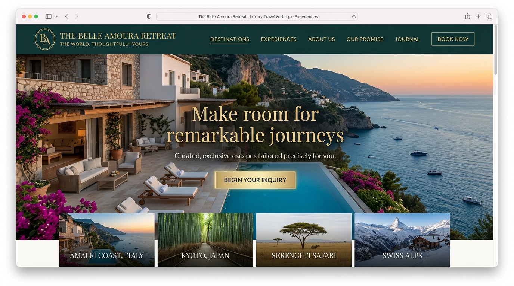

# THE BELLE AMOURA RETREAT
### *The World, Thoughtfully Yours*

Official repository for **The Belle Amoura Retreat** — Kenya's premier independent bespoke luxury travel agency and private retreat curator headquartered in Nairobi, Kenya.

---

## ✦ Website Preview & Visual Interface

Below is the verified desktop preview of the official **The Belle Amoura Retreat** homepage, showcasing the signature peacock green navigation bar, gold circular monogram emblem (`BA`), single-line wordmark, refined serif typography (*Playfair Display*), luxury cliffside sanctuary hero, and curated destination panorama strips:



*(Image file location in repository: `./website-preview.jpg` and `src/assets/website-preview.jpg`)*

---

## ✦ Direct Channels & Social Handles

- **Official Phone & WhatsApp Desk:** [`+254 706 168 307`](https://wa.me/254706168307)
- **Official Email:** `thebelleamouraretreat@gmail.com`
- **Instagram:** [`@thebelleamouraretreat`](https://www.instagram.com/thebelleamouraretreat/) (`https://www.instagram.com/thebelleamouraretreat/`)
- **TikTok:** [`@the.belle.amoura.retreat`](https://www.tiktok.com/@the.belle.amoura.retreat) (`https://www.tiktok.com/@the.belle.amoura.retreat`)
- **Location:** Nairobi Luxury Enclaves, Nairobi County, Kenya (East Africa & Worldwide)

---

## ✦ Repository Architecture & Key Files

```
├── server.js                   # Node.js/Express production server (clean standalone listener)
├── package.json                # Dependencies, start & dev build scripts
├── metadata.json               # Applet identity & runtime permissions
├── website-preview.jpg         # High-resolution screenshot of the official website
├── data/
│   └── crm-database.json       # In-built persistent luxury CRM client database
├── src/
│   ├── index.html              # Official Flagship Homepage (SEO Optimized with Schema.org)
│   ├── about.html              # Our Story, Slow Hospitality & Ethics
│   ├── experiences.html        # Curated Escapes & Sanctuary Grid
│   ├── gallery.html            # Visual Gallery (Editorial Direction)
│   ├── journal.html            # The Journal — Editorial Essays & Drops
│   ├── investors.html          # Strategic Investors & Capital Briefing
│   ├── careers.html            # Interactive Career Board & Talent Dossiers
│   ├── influencers.html        # Brand Influencer & Creator Alliance
│   ├── legal.html              # Legal & Corporate Counsel Retainer Mandate
│   ├── book-your-escape.html   # Bespoke Escape Questionnaire
│   ├── contact.html            # Concierge, Social Channels & WhatsApp Inquiries
│   ├── admin-inbox.html        # Executive Submissions & Bookings Command Center
│   ├── admin-portal.html       # Administration Suite with In-Built CRM Database
│   ├── admin-crm.js            # In-built CRM frontend management engine
│   ├── whatsapp-service.js     # WhatsApp formatter, instant webhook dispatcher & CRM engine
│   ├── robots.txt              # Search engine crawler directives & sitemap reference
│   ├── sitemap.xml             # XML sitemap covering all canonical pages
│   │
│   ├── the-amoura-atelier.html    # Standalone Portal: The Amoura Atelier
│   ├── the-sovereign-suite.html   # Standalone Portal: The Sovereign Suite
│   ├── the-meridian-exchange.html # Standalone Portal: The Meridian Exchange
│   ├── the-amoura-alliance.html   # Standalone Portal: The Amoura Alliance
│   ├── portal-home.html           # Universal Portal Atelier Directory
│   │
│   ├── styles.css              # Flagship public stylesheet (Palette & Components)
│   ├── brand-system.css        # Global brand emblem, wordmarks & color tokens
│   ├── inner-pages.css         # Inner editorial page heroes & layout grids
│   ├── consultant-studio.css   # The Amoura Atelier interactive workspace CSS
│   ├── portal-styles.css       # Universal portal directory styling
│   │
│   ├── app.js                  # Flagship client scripts, modals & wildlife dossiers
│   ├── nav.js                  # Navigation menu & scroll handling
│   ├── portal.js               # Multi-workspace portal controller
│   ├── consultant-studio.js    # Interactive consultant studio SPA
│   │
│   └── assets/
│       ├── logo-emblem.png     # Official circular gold emblem
│       └── website-preview.jpg # Official preview asset
```

---

## ✦ Key Systems & Capabilities

### 1. In-Built CRM Database in Admin Portal (`/admin-portal.html`)
- **Direct Route:** [`/admin-portal.html`](/admin-portal.html) and [`/portals/admin-portal.html`](/portals/admin-portal.html)
- **Persistence File:** `data/crm-database.json`
- **REST Endpoints:**
  - `GET /api/crm/clients` — Query, search, and filter by tier and status
  - `GET /api/crm/stats` — Real-time metrics (Total Patrons, Active Planning, Lifetime Pipeline, VIP Counts)
  - `POST /api/crm/clients` — Manually enroll new patrons
  - `PUT /api/crm/clients/:id` — Update notes, status, VIP tier, bookings, or consultant
  - `DELETE /api/crm/clients/:id` — Safely remove client records
- **Immediate Form Sync:**
  Whenever a guest submits a travel booking inquiry, a candidate submits a talent dossier, a creator pitches a residency, or an investor expresses interest, their information is **immediately recorded or updated in the CRM database**.
- **1-Click WhatsApp Concierge Liaison:**
  Every patron record features a direct `📲 WhatsApp` button linking straight to `https://wa.me/{phone}` with a tailored greeting.
- **Export to CSV:**
  Download full CRM database backups at any time with a single click.

### 2. Instant Mobile Webhook for WhatsApp (`+254 706 168 307`)
- **Owner WhatsApp Number:** `+254 706 168 307` (`254706168307`)
- When any form is submitted:
  1. The server formats the entire submission payload into clean, WhatsApp-ready markdown with emojis, ref IDs, and timestamps.
  2. If `WHATSAPP_WEBHOOK_URL` is set in the environment, the server immediately fires a webhook containing the structured message.
  3. The API response returns `whatsappUrl`, enabling a 1-click button on the user interface: `[📲 Transmit directly to WhatsApp Concierge (+254 706 168 307) ↗]`.
  4. The form displays the exact required confirmation message:
     > **"Form submitted successfully. The B.A.R will get back to you as soon as we can"**

### 3. SEO Optimization for Kenya & Nairobi Searches
Configured in strict accordance with the `applet-seo` standard to capture high-intent organic traffic:
- **Keywords:** `travel agencies in kenya`, `travel agency nairobi`, `retreats kenya`, `luxury retreats nairobi`, `the belle amoura retreat`, `bespoke safari kenya`, `luxury travel planner nairobi`, `maasai mara luxury safari`, `diani beach private villas`, `lamu retreats`, `corporate retreats kenya`, `wellness retreats kenya`.
- **Structured Data (Schema.org JSON-LD):**
  - `@type: ["TravelAgency", "LodgingBusiness", "LocalBusiness"]`
  - Geo coordinates for Nairobi: `-1.286389, 36.817223` (Region `KE-30`)
  - Complete `hasOfferCatalog` with bespoke Kenya safaris, coastal villas, corporate retreats, and international journeys.
  - `FAQPage` rich snippets answering questions about luxury travel and WhatsApp booking in Kenya.
- **Social Share Cards:**
  - Standard OpenGraph tags (`og:title`, `og:description`, `og:image`, `og:locale: en_KE`)
  - Twitter / X cards (`summary_large_image`, `@thebelleamouraretreat`)
- **Search Engine Discovery:**
  - `src/robots.txt`
  - `src/sitemap.xml` covering all 16 canonical public and portal URLs.

---

## ✦ Production Deployment (Vercel & Local)

### Deploy to Vercel (Recommended)
The project is configured for **Vercel** via `vercel.json`, `api/index.js`, and `scripts/build-vercel.mjs`:
- **Static Edge CDN Output (`dist/`):** `npm run build` assembles all HTML, CSS, JavaScript, portals, and image assets from `public/`, `src/`, and `portals/` into `dist/`.
- **Express Serverless API (`api/index.js`):** Routes `/api/*` requests to `server.js` as a Vercel Serverless Function, with `/tmp/crm-database.json` fallback for serverless CRM updates.
- **Clean URLs & Rewrites:** Configured in `vercel.json` so all clean paths (`/about`, `/atelier`, `/sovereign`, `/meridian`, `/alliance`, `/admin-inbox`, `/portal-home`, etc.) and redirects (`/creators`, `/portals`) work seamlessly on Vercel.

To deploy via GitHub + Vercel:
1. Sync/push this project to your GitHub repository **`The-Belle-Amoura-Retreat`**.
2. Import **`The-Belle-Amoura-Retreat`** in the [Vercel Dashboard](https://vercel.com/new) (Framework Preset: **Other**, Build Command: `npm run build`, Output Directory: `dist`).
3. Add optional environment variables (e.g., `WHATSAPP_WEBHOOK_URL`) in **Vercel Project Settings → Environment Variables**.
4. Every commit pushed to `main` automatically verifies the build via `.github/workflows/ci-vercel.yml` and triggers a production Vercel deployment.

### Run Locally / Standalone Node Server
```bash
# 1. Install dependencies
npm install

# 2. Build static assets into dist/
npm run build

# 3. Start local Express server (runs on port 3000)
npm start
```
The local server runs on `http://0.0.0.0:3000`.

